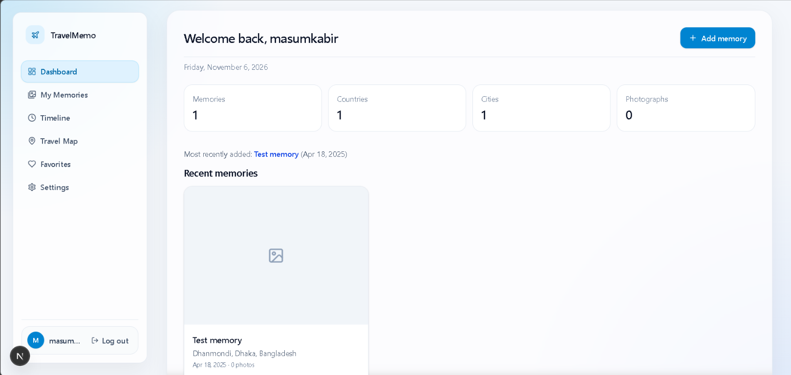

# TravelMemo

TravelMemo is a polished, local-first travel journal for documenting memories, destinations, and day-by-day experiences in a clean, private workspace.

## Screenshot



## Overview

This project gives travelers a simple way to:

- Save memorable moments by destination and date
- Organize favorite places and highlights
- Review trip statistics from a professional dashboard
- Keep data private in a local-first workflow
- Export a backup of all stored memories
- Share interesting travel moments with others

## Project goals

TravelMemo was designed to feel calm, premium, and personal. The app emphasizes a professional user experience while staying lightweight enough to run locally without relying on a cloud backend.

## Tech stack

- Next.js 15
- React 19
- TypeScript
- CSS modules / custom styling
- Local storage for travel data

## Run locally

```bash
npm install
npm run dev
```

Then open http://localhost:3000 in the browser.

## Production build

```bash
npm run build
npm run start
```

## Notes

This project is intentionally designed for personal use and self-hosted travel journaling. It keeps your information local and easy to manage, while still delivering a modern, professional app feel.
